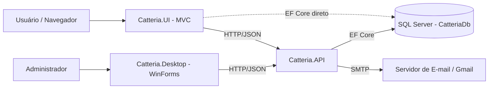
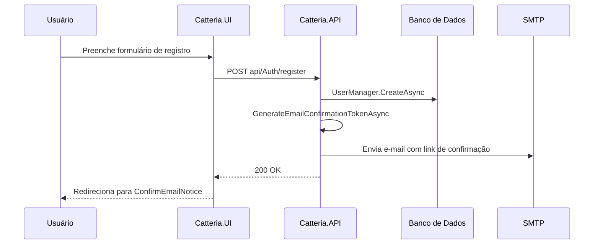
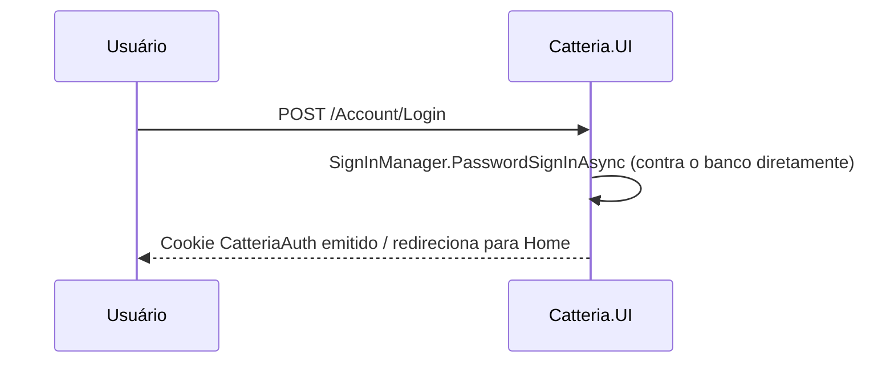
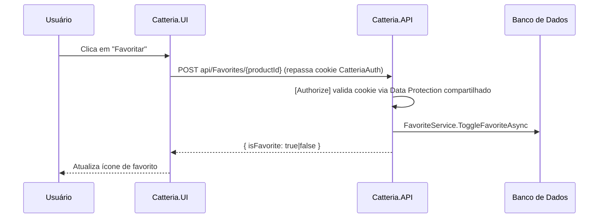
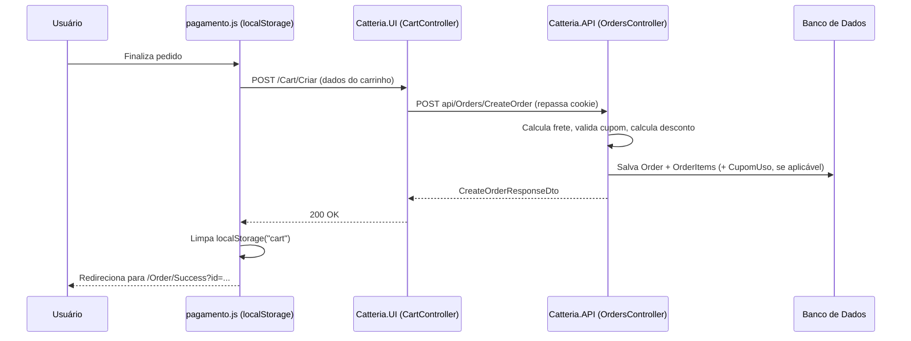
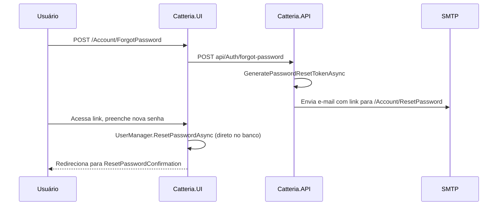

# Catteria ☕ — Sistema de Gestão de Cafeteria

Documentação técnica oficial do projeto **Catteria**, refletindo o estado atual do código-fonte. Este README foi gerado a partir da análise direta dos arquivos do repositório (projetos `.csproj`, `Program.cs`, controllers, entidades, migrations e arquivos de configuração).

> ⚠️ Sempre que uma informação não pôde ser confirmada no código/configuração, ela está marcada explicitamente como **"Informação não identificada no projeto — precisa ser configurada/verificada manualmente."**

---

## Índice

1. [Visão Geral do Projeto](#1-visão-geral-do-projeto)
2. [Estrutura da Solução](#2-estrutura-da-solução)
3. [Árvore de Diretórios](#3-árvore-de-diretórios)
4. [Tecnologias e Dependências](#4-tecnologias-e-dependências)
5. [Banco de Dados](#5-banco-de-dados)
6. [Identity e Autenticação](#6-identity-e-autenticação)
7. [Confirmação de E-mail](#7-confirmação-de-e-mail)
8. [Recuperação de Senha](#8-recuperação-de-senha)
9. [Produtos e Categorias](#9-produtos-e-categorias)
10. [Favoritos](#10-favoritos)
11. [Carrinho](#11-carrinho)
12. [Pedidos / Checkout](#12-pedidos--checkout)
13. [Cupons](#13-cupons)
14. [API — Endpoints](#14-api--endpoints)
15. [UI — Estrutura Web (MVC)](#15-ui--estrutura-web-mvc)
16. [Catteria.Desktop (Aplicação Desktop)](#16-catteriadesktop-aplicação-desktop)
17. [Configuração Local](#17-configuração-local)
18. [Variáveis de Ambiente](#18-variáveis-de-ambiente)
19. [Deploy no Azure](#19-deploy-no-azure)
20. [Configurações Específicas do Azure (Checklist)](#20-configurações-específicas-do-azure-checklist)
21. [Diferenças entre Desenvolvimento e Produção](#21-diferenças-entre-desenvolvimento-e-produção)
22. [Segurança](#22-segurança)
23. [Solução de Problemas (Troubleshooting)](#23-solução-de-problemas-troubleshooting)
24. [Fluxos Importantes](#24-fluxos-importantes)
25. [Estrutura de Configuração](#25-estrutura-de-configuração)
26. [Checklist para Novo Desenvolvedor](#26-checklist-para-novo-desenvolvedor)
27. [Checklist para Deploy](#27-checklist-para-deploy)
28. [Observações e Inconsistências Encontradas](#28-observações)

---

## 1. Visão Geral do Projeto

**Catteria** é uma solução de gestão para uma cafeteria (com identidade visual temática de gatos, conforme `ROADMAP.md`), desenvolvida em **.NET 10** com arquitetura em camadas (aproximando-se de Clean Architecture / DDD). O sistema permite que clientes naveguem por um cardápio de produtos, montem um carrinho de compras, apliquem cupons de desconto, finalizem pedidos e acompanhem seu status, além de oferecer um painel administrativo para gerenciar produtos, categorias, pedidos e cupons.

### Principais funcionalidades confirmadas no código

- Catálogo de produtos com categorias e produtos em destaque
- Carrinho de compras (client-side, via `localStorage`)
- Checkout com forma de pagamento (Pix, cartão ou retirada), frete e cupom de desconto
- Sistema de pedidos com status (`OrderStatus`) e rastreamento
- Sistema de favoritos por usuário
- Sistema de cupons de desconto com controle de uso único por usuário
- Autenticação e autorização via ASP.NET Core Identity (roles `Admin` e `Usuario`)
- Confirmação de e-mail e recuperação de senha por e-mail (SMTP)
- Painel administrativo web (CRUD de produtos e categorias, dashboard)
- API RESTful com Swagger
- Aplicação desktop (Windows Forms) administrativa, que consome a mesma API

### Arquitetura geral

A `Catteria.UI` (aplicação web MVC voltada ao cliente final) e a `Catteria.Desktop` (aplicação Windows Forms administrativa) consomem a `Catteria.API`, que por sua vez acessa o banco de dados através da camada `Catteria.Infraestructure`. Além disso, a `Catteria.UI` também acessa o banco de dados **diretamente** via Entity Framework Core para as operações de login e reset de senha (ver seção [6](#6-identity-e-autenticação)).



---

## 2. Estrutura da Solução

A solução (`Catteria.slnx`) é composta por **6 projetos**:

| Projeto | Tipo de SDK | Responsabilidade |
|---|---|---|
| `Catteria.Domain` | Class Library | Entidades de domínio e interfaces de repositório. Núcleo da aplicação, sem dependências de outros projetos. |
| `Catteria.Application` | Class Library | DTOs, ViewModels, interfaces de serviço e implementação dos serviços de aplicação (regras de negócio). Depende de `Catteria.Domain`. |
| `Catteria.Infraestructure` | Class Library | `DbContext` (EF Core), implementação dos repositórios, Identity, envio de e-mail (MailKit), configurações de mapeamento EF e Data Protection. Depende de `Catteria.Application` e `Catteria.Domain`. |
| `Catteria.API` | ASP.NET Core Web (`Microsoft.NET.Sdk.Web`) | API REST (controllers `[ApiController]`), Swagger, Identity/cookie auth, CORS. Depende de `Catteria.Application` e `Catteria.Infraestructure`. |
| `Catteria.UI` | ASP.NET Core Web (`Microsoft.NET.Sdk.Web`) | Aplicação MVC (Razor Views) para o cliente final e painel admin. Depende de `Catteria.Application` e `Catteria.Infraestructure`. |
| `Catteria.Desktop` | WinForms (`net10.0-windows`) | Aplicação desktop administrativa (Windows Forms + Guna.UI2), consome a `Catteria.API` via HTTP. Depende apenas de `Catteria.Application` (para os DTOs — o projeto também define os próprios DTOs em `Catteria.Desktop/DTOs`). |

### Regra de dependências (Clean Architecture)

```
Catteria.API ──┐
               ├──> Catteria.Infraestructure ──> Catteria.Application ──> Catteria.Domain
Catteria.UI ───┘
Catteria.Desktop ───────────────────────────────> Catteria.Application (DTOs)
```

`Catteria.Domain` não depende de nenhum outro projeto. `Catteria.Application` depende apenas de `Catteria.Domain`. `Catteria.Infraestructure` implementa as interfaces definidas em `Catteria.Domain` e usa os DTOs de `Catteria.Application`. `Catteria.API` e `Catteria.UI` são os pontos de entrada (hosts), configurando injeção de dependência, middlewares e consumindo as camadas inferiores.

### Descrição das camadas

#### `Catteria.Domain`
- **Entidades** (`Domain/Entities`): `Product`, `Category`, `Order`, `OrderItem`, `OrderStatus`, `Cupom`, `CupomUso`, `Favorite`, `ApplicationUser` (`User.cs`, estende `IdentityUser`).
- **Interfaces** (`Domain/Interfaces`): `IProductRepository`, `ICategoryRepository`, `IOrderRepository`, `IOrderItemRepository`, `ICupomRepository`, `IFavoriteRepository`, `IEmailSender`.
- Não depende de nenhuma tecnologia externa (sem EF Core, sem ASP.NET) — exceto `User.cs`, que referencia `Microsoft.AspNetCore.Identity.IdentityUser`.

#### `Catteria.Application`
- **DTOs** (`Application/DTOs`): `AuthDto` (Login/Register/Reset), `CategoryDto`, `CuponsDto`, `OrderDto`, `OrderItemDto`, `OrderStatusDto`, `ProductDto`, `UsuarioDto`.
- **ViewModels** (`Application/ViewModels/ViewModels.cs`): `HomeViewModel`, `ProductListViewModel`, `ProductDetailsViewModel`, `ProductFormViewModel`, `OrderDetailsViewModel`, `DashboardViewModel` — usados pela `Catteria.UI`.
- **Interfaces de serviço** (`Application/Interfaces`): `ICategoryService`, `IFavoriteService` (namespace `Catteria.Application.Services`, não `.Interfaces`), `IOrderService`, `IProductService`, `IUsuarioService` (definida em `IUsuarioController.cs`).
- **Serviços** (`Application/Services`): `CategoryService`, `CupomService`, `FavoriteService`, `OrderItemService` (sem interface própria), `OrderService`, `ProductService`, `UsuarioService`.

#### `Catteria.Infraestructure`
- **Context** (`Infraestructure/Context/CatteriaDbContext.cs`): estende `IdentityDbContext<ApplicationUser>`.
- **Identity** (`Infraestructure/Identity/SeedData.cs`): popula categorias, produtos, roles e usuário admin inicial.
- **Configurations** (`Infraestructure/Configurations`): mapeamentos Fluent API (`CategoryConfiguration`, `CupomConfiguration`, `CupomUsoConfiguration`, `FavoriteConfiguration`, `OrderConfiguration`, `OrderItemConfiguration`, `ProductConfiguration`) e `FixedXmlRepository` (Data Protection compartilhado entre API e UI).
- **Repositories** (`Infraestructure/Repositories`): implementações EF Core de todos os repositórios do Domain, mais `EmailSender` (namespace `Catteria.Infraestructure.Services`, usando MailKit/SMTP).

#### `Catteria.API`
- **Controllers** (`API/Controllers`): `AuthController`, `CategoriesController`, `CuponsController`, `FavoritesController` (classe `FavoritesController`, arquivo `FavoriteController.cs`), `OrdersController`, `ProductsController`, `UsuarioController`.
- Expõe endpoints REST, protegidos por `[Authorize]`/`[Authorize(Roles = "Admin")]` quando aplicável, documentados via Swagger.

#### `Catteria.UI`
- **Controllers** (`UI/Controllers`): `AccountController`, `AdminController`, `CartController`, `FavoritesController`, `HomeController`, `OrderController`, `ProductsController`.
- **Views** (Razor, `.cshtml`) organizadas por controller em `UI/Views`.
- Consome a `Catteria.API` via `IHttpClientFactory` (cliente nomeado `"CatteriaApi"`), repassando o cookie de autenticação nas chamadas que exigem usuário logado.
- Login e reset de senha são processados **localmente** pela própria `Catteria.UI`, usando `SignInManager`/`UserManager` do ASP.NET Identity diretamente contra o mesmo banco de dados da API (ver seção 6).

#### `Catteria.Desktop`
- Aplicação Windows Forms (Guna.UI2) para administração (produtos, categorias, pedidos, usuários, cupons), consumindo a `Catteria.API` via `HttpClient` (`Desktop/Services/*ApiService.cs`).
- Resolve a URL da API automaticamente a partir do `launchSettings.json` da `Catteria.API` (em tempo de desenvolvimento) ou de um `appsettings.json` próprio (`ApiSettings:BaseUrl`) — ver `Desktop/Helpers/ApiEndPointResolver.cs`.

---

## 3. Árvore de Diretórios

```
Catteria/
├── Catteria.slnx
├── README.md
├── ROADMAP.md
│
├── Catteria.Domain/
│   ├── Entities/
│   │   ├── Category.cs
│   │   ├── Cupom.cs
│   │   ├── CupomUso.cs
│   │   ├── Favorite.cs
│   │   ├── Order.cs
│   │   ├── OrderItem.cs
│   │   ├── OrderStatus.cs
│   │   ├── Product.cs
│   │   └── User.cs                         (ApplicationUser : IdentityUser)
│   └── Interfaces/
│       ├── ICategoryRepository.cs
│       ├── ICupomRepository.cs
│       ├── IEmailSender.cs
│       ├── IFavoriteRepository.cs
│       ├── IOrderItemRepository.cs
│       ├── IOrderRepository.cs
│       └── IProductRepository.cs
│
├── Catteria.Application/
│   ├── DTOs/                               (AuthDto, CategoryDto, CuponsDto, OrderDto, OrderItemDto, OrderStatusDto, ProductDto, UsuarioDto)
│   ├── Interfaces/                         (ICategoryService, IFavoriteService, IOrderService, IProductService, IUsuarioController.cs → IUsuarioService)
│   ├── Services/                           (CategoryService, CupomService, FavoriteService, OrderItemService, OrderService, ProductService, UsuarioService)
│   └── ViewModels/ViewModels.cs
│
├── Catteria.Infraestructure/
│   ├── Configurations/                     (mapeamentos EF Core + FixedXmlRepository.cs)
│   ├── Context/CatteriaDbContext.cs
│   ├── Identity/SeedData.cs
│   ├── Migrations/                         (1 migration: 20260909170914_Teste)
│   └── Repositories/                       (implementações EF Core + EmailSender.cs)
│
├── Catteria.API/
│   ├── Controllers/                        (AuthController, CategoriesController, CuponsController, FavoriteController.cs, OrdersController, ProductsController, UsuarioController)
│   ├── Properties/
│   │   ├── launchSettings.json
│   │   └── PublishProfiles/                (4 perfis: FTP, Web Deploy x2, Zip Deploy)
│   ├── appsettings.json                  
│   ├── appsettings.Development.json
│   └── Program.cs
│
├── Catteria.UI/
│   ├── Controllers/                        (AccountController, AdminController, CartController, FavoritesController, HomeController, OrderController, ProductsController)
│   ├── Models/
│   ├── Views/
│   │   ├── Account/  Admin/  Cart/  Favorites/  Home/  Order/  Products/  Shared/
│   ├── wwwroot/
│   │   ├── css/                            (Cart.css, DashboardAdmin.css, Details.css, Favorites.css, Layout.css, Menu.css, MyOrders.css, home.css, site.css, tracking.css)
│   │   ├── js/                             (cart.js, favorites.js, pagamento.js, shared-scripts.js, site.js)
│   │   ├── lib/                            (bootstrap, jquery, jquery-validation)
│   │   └── Imagens/
│   ├── Properties/
│   │   ├── launchSettings.json
│   │   └── PublishProfiles/app-catteria-ui - Web Deploy.pubxml
│   ├── appsettings.json                    
│   ├── appsettings.Development.json
│   └── Program.cs
│
└── Catteria.Desktop/
    ├── DTOs/  Forms/  Helpers/  Services/  Themes/  UserControls/  Properties/
    └── Program.cs
```

---

## 4. Tecnologias e Dependências

Versões extraídas diretamente dos arquivos `.csproj`.

| Tecnologia | Versão | Projeto(s) | Função |
|---|---|---|---|
| .NET | `net10.0` (`net10.0-windows` no Desktop) | Todos | Framework alvo de todos os projetos |
| ASP.NET Core | 10 (via `Microsoft.NET.Sdk.Web`) | `API`, `UI` | Hospedagem web (MVC / Web API) |
| Entity Framework Core | 10.0.9 (`Infraestructure`, `API`, `UI`), 10.0.0 (`Catteria.csproj` na raiz) | `Infraestructure`, `API`, `UI` | ORM de acesso ao SQL Server |
| Microsoft.EntityFrameworkCore.SqlServer | 10.0.9 (`Infraestructure`), 10.0.0 (`Catteria.csproj` raiz) | `Infraestructure`, raiz | Provider SQL Server para o EF Core |
| Microsoft.EntityFrameworkCore.Tools | 10.0.9 | `Infraestructure` | Ferramentas de migration (CLI/Package Manager Console) |
| Microsoft.EntityFrameworkCore.Design | 10.0.9 (`API`), 10.0.0 (raiz) | `API`, raiz | Suporte a `dotnet ef` |
| Microsoft.AspNetCore.Identity.EntityFrameworkCore | 10.0.9 | `Infraestructure` | Persistência do ASP.NET Identity via EF Core |
| Microsoft.Extensions.Identity.Stores | 10.0.10 | `Application` | Contratos de armazenamento do Identity usados nos DTOs/serviços |
| Microsoft.AspNetCore.DataProtection | 10.0.12 | `Infraestructure` | Base da criptografia de cookies/Data Protection |
| Azure.Extensions.AspNetCore.DataProtection.Blobs | 1.5.4 | `API`, `UI` | Referenciado, mas **não utilizado** no código (ver seção 28) |
| MailKit | 4.17.0 | `Infraestructure` | Envio de e-mails via SMTP (`EmailSender`) |
| Swashbuckle.AspNetCore | 10.2.3 | `API` | Geração da documentação Swagger/OpenAPI |
| Microsoft.AspNetCore.OpenApi | 10.0.9 | `API` | Suporte OpenAPI nativo do ASP.NET Core |
| Guna.UI2.WinForms | 2.0.4.8 | `Desktop` | Componentes visuais modernos para Windows Forms |
| System.Resources.Extensions | 10.0.11 | raiz (`Catteria.csproj`) | Suporte a recursos não-string em `.resx` |
| Bootstrap / jQuery / jQuery Validation | conforme arquivos em `wwwroot/lib` | `UI` | Front-end (estilo, validação de formulários) |
| Banco de dados | SQL Server (Azure SQL Database, conforme `appsettings.json`) | `Infraestructure`, `API`, `UI` | Persistência relacional |
| Swagger | via Swashbuckle | `API` | UI interativa em `/` (ver `RoutePrefix = string.Empty` no `Program.cs`) |
| Azure | App Service (Web Apps), conforme perfis de publicação | `API`, `UI` | Hospedagem em produção (região `brazilsouth`) |

---

## 5. Banco de Dados

- **Banco de dados**: SQL Server (Azure SQL Database — `appsettings.json` aponta para `sql-catteria.database.windows.net`, banco `CatteriaDb`).
- **ORM**: Entity Framework Core.
- **DbContext**: `Catteria.Infraestructure.Context.CatteriaDbContext`, que estende `IdentityDbContext<ApplicationUser>` (inclui automaticamente as tabelas do ASP.NET Identity: `AspNetUsers`, `AspNetRoles`, `AspNetUserRoles`, etc.).

### DbSets declarados

`OrderItems`, `Orders`, `Categories`, `Favorites`, `Products`, `Cupons`, `CupomUsos`, `OrderStatuses` — além dos DbSets herdados do Identity.

### Entidades principais e relacionamentos

| Entidade | Relacionamentos | Observações |
|---|---|---|
| `Product` | N:1 com `Category`; 1:N com `OrderItem` | `Category` obrigatória (`OnDelete: Restrict`) |
| `Category` | 1:N com `Product` | — |
| `Order` | N:1 com `ApplicationUser` (`IdUser`, `OnDelete: Restrict`); N:1 com `OrderStatus` (`OnDelete: Restrict`); 1:N com `OrderItem` | Campos de cupom (`CupomId`, `CupomCodigo`, `Desconto`, `PercentualDesconto`) direto na entidade |
| `OrderItem` | N:1 com `Order`; N:1 com `Product` | — |
| `OrderStatus` | 1:N com `Order` | 7 status populados via `HasData` (seed de migration, ver abaixo) |
| `Favorite` | Chave composta (`UserId`, `ProductId`); N:1 com `ApplicationUser` (`Cascade`); N:1 com `Product` (`Cascade`) | — |
| `Cupom` | Entidade rica (construtor privado + métodos de domínio `Ativar`/`Desativar`/`AtualizarDesconto`/`AtualizarCodigo`) | Código único (`HasIndex().IsUnique()`) |
| `CupomUso` | Registra `CupomId` + `UsuarioId` + `OrderId` | Índice único composto (`CupomId`, `UsuarioId`) — garante 1 uso por cupom por usuário |
| `ApplicationUser` | Estende `IdentityUser`; 1:N com `Order`; 1:N com `Favorite` | Campos extras: `Name`, `Address` |

### Status de pedido (seed via `OnModelCreating`)

| Id | Nome | Descrição |
|---|---|---|
| 1 | Pendente | Pedido recebido e aguardando confirmação |
| 2 | Confirmado | Pedido confirmado |
| 3 | Preparando | O pedido está sendo preparado |
| 4 | Pronto | O pedido está pronto |
| 5 | Saiu para entrega | O pedido está a caminho |
| 6 | Entregue | Pedido entregue ao cliente |
| 7 | Cancelado | Pedido cancelado |

### Migrations

Existe **uma única migration** no projeto: `20260909170914_Teste` (`Catteria.Infraestructure/Migrations`). Ela cria todas as 15 tabelas do schema atual (entidades de negócio + tabelas do Identity). 

### Seed inicial

`Catteria.Infraestructure.Identity.SeedData.SeedAsync` é chamado no `Program.cs` de **ambos** `Catteria.API` e `Catteria.UI` na inicialização (dentro de um `try/catch` que apenas loga o erro sem derrubar a aplicação). Ele é idempotente (verifica `Any()` antes de inserir) e executa `context.Database.MigrateAsync()` automaticamente. Popula:

1. **Categorias**: Café, Bolos, Biscoitos, Chá, Bebidas quentes, Bebidas geladas, Sobremesas, Sanduiches, Salgados.
2. **Produtos de exemplo**: 8 produtos distribuídos entre as categorias acima (todos usando a mesma URL de imagem de exemplo hospedada em `sloopsorvetes.com.br`).
3. **Roles**: `Admin` e `Usuario`.
4. **Usuário administrador padrão**: e-mail `admin@catteria.com`, senha `Admin@123`, com `EmailConfirmed = true` e role `Admin`. 

### Configuração da connection string

A connection string é lida via `builder.Configuration.GetConnectionString("DefaultConnection")` tanto em `Catteria.API/Program.cs` quanto em `Catteria.UI/Program.cs` (ambos os projetos se conectam **diretamente** ao mesmo banco de dados). Formato esperado (SQL Server):

```json
{
  "ConnectionStrings": {
    "DefaultConnection": "Server=<SERVIDOR>;Initial Catalog=<BANCO>;User ID=<USUARIO>;Password=<SENHA>;Encrypt=True;TrustServerCertificate=False;Connection Timeout=30;"
  }
}
```

### Diferença entre ambiente local e produção

- **Local**: nenhuma connection string é fornecida via `appsettings.Development.json` (o arquivo local não contém `ConnectionStrings`, embora esteja listado no `.gitignore`). É necessário configurar uma connection string local (LocalDB, SQL Express, ou apontar para o mesmo Azure SQL) via User Secrets.
- **Produção (Azure)**: a connection string deve vir de uma Application Setting no App Service, não do `appsettings.json` comitado.

---

## 6. Identity e Autenticação

O sistema usa **ASP.NET Core Identity** com a entidade `ApplicationUser` (`Domain/Entities/User.cs`, que estende `IdentityUser`), configurado tanto em `Catteria.API/Program.cs` quanto em `Catteria.UI/Program.cs` via:

```csharp
builder.Services.AddIdentity<ApplicationUser, IdentityRole>(options =>
{
    options.Password.RequireDigit = true;
    options.Password.RequireLowercase = true;
    options.Password.RequireUppercase = true;
    options.Password.RequireNonAlphanumeric = true;
    options.Password.RequiredLength = 6;
})
.AddEntityFrameworkStores<CatteriaDbContext>()
.AddDefaultTokenProviders();
```

Ou seja, a senha exige no mínimo 6 caracteres, com letra maiúscula, minúscula, número e caractere especial.

### Como a autenticação funciona entre UI e API (cookie compartilhado)

`Catteria.API` e `Catteria.UI` são **duas aplicações ASP.NET Core hospedadas separadamente**, mas compartilham o **mesmo cookie de autenticação** (`options.Cookie.Name = "CatteriaAuth"`, configurado nos dois projetos) e o **mesmo esquema de Data Protection**. Isso é feito através de `FixedXmlRepository` (`Infraestructure/Configurations/FixedXmlRepository.cs`):

- Se a Application Setting `DataProtection:KeyXmlBase64` estiver configurada (produção/Azure), ambos os apps usam a **mesma chave fixa** de Data Protection (fornecida como XML codificado em Base64), com `DisableAutomaticKeyGeneration()` — ou seja, nenhuma chave nova é gerada em runtime.
- Se a variável não estiver configurada (ambiente local), cada aplicação usa seu comportamento padrão de Data Protection (chaves próprias, não compartilhadas entre UI e API).

Isso permite que um cookie de autenticação emitido por um dos apps seja validado pelo outro — essencial para o fluxo descrito abaixo.

### Fluxo de autenticação por funcionalidade

| Ação | Onde é processada | Como |
|---|---|---|
| **Registro** (`/Account/Register` na UI) | `Catteria.UI.AccountController` faz uma chamada HTTP para `POST api/Auth/register` na API | A API cria o usuário via `UserManager`, gera o token de confirmação de e-mail e envia o e-mail |
| **Login** (`/Account/Login` na UI) | `Catteria.UI.AccountController` usa `SignInManager<ApplicationUser>` **diretamente**, conectado ao mesmo banco | A UI **não** chama a API para autenticar — realiza o login localmente e emite o cookie compartilhado |
| **Login via API** (`POST api/Auth/login`) | `Catteria.API.AuthController` | Usado por clientes que consomem a API diretamente (ex.: `Catteria.Desktop`) |
| **Logout** | Ambos os projetos têm sua própria action `Logout` (`SignInManager.SignOutAsync()`) | — |
| **Esqueci a senha** | `Catteria.UI.AccountController.ForgotPassword` chama `POST api/Auth/forgot-password` na API | A API gera o token e envia o e-mail com link para a UI |
| **Redefinir senha** | `Catteria.UI.AccountController.ResetPassword` usa `UserManager` **diretamente** | Processado localmente pela UI, sem chamar a API |

### Como a UI identifica o usuário ao chamar a API

Para as chamadas que exigem usuário autenticado (ex.: `CartController.Criar`, `FavoritesController.Toggle`), a `Catteria.UI` repassa manualmente o cookie da requisição original para a chamada HTTP feita à API:

```csharp
var cookie = Request.Headers["Cookie"].ToString();
var request = new HttpRequestMessage(HttpMethod.Post, "api/Orders/CreateOrder") { Content = ... };
request.Headers.Add("Cookie", cookie);
```

Como a API valida o mesmo cookie `CatteriaAuth` (graças às chaves de Data Protection compartilhadas), ela reconhece o usuário autenticado sem necessidade de um token separado.

### Como o ID do usuário é obtido (favoritos, pedidos, carrinho)

- Na **API**, o ID do usuário é obtido via `UserManager.GetUserId(User)` (em `CuponsController`, `OrdersController`) ou via `User.FindFirst(ClaimTypes.NameIdentifier)` / `User.FindFirstValue(ClaimTypes.NameIdentifier)` (em `FavoritesController`).
- Na **UI**, quando necessário (ex.: `OrderController.MyOrders`, `OrderController.Tracking`), o ID é obtido via `UserManager.GetUserId(User)`.
- O **carrinho** não depende do ID do usuário — é armazenado inteiramente no `localStorage` do navegador (ver seção 11).

### Roles e autorização

- Roles existentes: `Admin` e `Usuario` (criadas em `SeedData`).
- `[Authorize(Roles = "Admin")]` protege as operações de escrita (`POST`/`PUT`/`DELETE`) de `CategoriesController`, `ProductsController`, `CuponsController` (exceto validação), `OrdersController` (update/delete) e `UsuarioController` (update/delete), e todo o `Catteria.UI.AdminController`.
- `[Authorize]` (sem role específica) protege endpoints que exigem apenas usuário autenticado, como criação de pedido, favoritos e validação de cupom.

---

## 7. Confirmação de E-mail

Fluxo: **Registro → criação do usuário → geração do token → envio do e-mail → link → API confirma → redireciona para a UI**.

1. `POST api/Auth/register` (`AuthController`, `Catteria.API`) cria o `ApplicationUser` via `UserManager.CreateAsync`.
2. Gera o token com `UserManager.GenerateEmailConfirmationTokenAsync(user)`.
3. Monta o link de confirmação apontando para a própria API (`LinkGenerator.GetUriByAction(..., action: "ConfirmarEmail", controller: "Auth", ...)`).
4. Envia o e-mail via `IEmailSender.SendEmailAsync` (implementado por `Catteria.Infraestructure.Services.EmailSender`, usando MailKit/SMTP).
5. O usuário clica no link, que abre `GET api/Auth/confirmar-email?userId=...&token=...` **na API**.
6. `AuthController.ConfirmarEmail` chama `UserManager.ConfirmEmailAsync` e então **redireciona o navegador para a UI** (`{ClientUrl}/Account/confirmacao?sucesso=true|false&mensagem=...`).
7. A UI exibe a página `Account/confirmacao.cshtml` (controller `AccountController.confirmacao`), lendo `sucesso` e `mensagem` da query string.

### Reenvio de confirmação

- UI: `GET/POST /Account/ReenviarConfirmacao` → chama `POST api/Auth/reenviar-confirmacao` na API (`FormUrlEncodedContent`).
- API: `AuthController.ReenviarConfirmacao` usa `IMemoryCache` para impedir reenvios repetidos (chave `reenvio-confirmacao:{userId}`, 60 segundos de bloqueio) e está decorado com `[EnableRateLimiting("reenviar-confirmacao")]`.

### Configurações necessárias

- Seção `Email` (`From`, `Host`, `Port`, `User`, `Password`) via `IConfiguration`, consumida por `Catteria.Infraestructure.Services.EmailSender`.
- `ClientUrl` (lida por `AuthController.GetClientUrl()`), usada para montar os links enviados por e-mail que apontam de volta para a UI. Tem um fallback hardcoded para a URL de produção da UI no Azure caso a configuração não exista.
- Dependência de **Data Protection** compartilhado entre API e UI (ver seção 6) para que os tokens de confirmação/reset gerados pela API — que dependem de Data Protection por baixo dos panos no ASP.NET Identity — continuem válidos ao longo do fluxo.

---

## 8. Recuperação de Senha

Fluxo: **"Esqueci minha senha" → UI chama API → API gera token e envia e-mail → link aponta para a UI → UI processa a redefinição diretamente no banco**.

| Etapa | Camada | Detalhe |
|---|---|---|
| Exibir formulário "Esqueci a senha" | UI (`AccountController.ForgotPassword` GET) | `[AllowAnonymous]` |
| Solicitar redefinição | UI → API | `POST /Account/ForgotPassword` (UI, com `[EnableRateLimiting("forgot-password")]`, 3 tentativas / 15 min por IP) chama `POST api/Auth/forgot-password` |
| Gerar token e enviar e-mail | API (`AuthController.ForgotPassword`) | Não revela se o e-mail existe; gera token com `GeneratePasswordResetTokenAsync`; monta link para `{ClientUrl}/Account/ResetPassword?userId=...&token=...`; envia via `IEmailSender` |
| Exibir formulário de nova senha | UI (`AccountController.ResetPassword` GET) | Recebe `userId` e `token` da query string |
| Validar e salvar nova senha | UI (`AccountController.ResetPassword` POST) | Usa `UserManager.ResetPasswordAsync` **diretamente** — não chama a API |
| Confirmação | UI (`ResetPasswordConfirmation`) | Página de sucesso |

A API também expõe `POST api/Auth/reset-password` (usado, por exemplo, pelo `Catteria.Desktop` ou outros consumidores diretos da API), mas o fluxo padrão da `Catteria.UI` redefine a senha localmente via `UserManager`, e não através desse endpoint.

Nenhuma configuração adicional além de `Email:*` e `ClientUrl` (seção 7) e Data Protection compartilhado é necessária para este fluxo funcionar em produção.

---

## 9. Produtos e Categorias

### `Product`
Campos: `Id`, `Price`, `Name`, `Description`, `CoverImageUrl`, `CategoryId` (FK), `IsFeatured`, `CreatedAt`. Relacionamento N:1 com `Category` e 1:N com `OrderItem`.

### `Category`
Campos: `Id`, `Name`. Relacionamento 1:N com `Product`.

### CRUD
Implementado via `ProductService`/`CategoryService` (camada Application) e exposto tanto pela API (`ProductsController`, `CategoriesController`) quanto pelo painel administrativo da UI (`AdminController` — `Product`, `CreateProduct`, `UpdateProduct`, `DeleteProduct`, `Categories`, `CreateCategory`, `UpdateCategory`, `DeleteCategory`).

### Imagens
`CoverImageUrl` é uma URL de imagem armazenada como texto simples no banco (não há upload de arquivos/blob storage identificado no código — os produtos de seed usam uma URL externa fixa).

### Produtos em destaque
`Product.IsFeatured` (bool). Exibidos na Home (`HomeController.Index` → `IProductService.GetFeaturedAsync()`).

### Como os dados chegam à UI
- `ProductsController` (UI) monta um `ProductListViewModel`/`ProductDetailsViewModel` chamando `IProductService`/`ICategoryService` **diretamente** (não via HTTP para a API — a UI referencia `Catteria.Application`/`Catteria.Infraestructure` e injeta os serviços localmente).
- Suporta filtro por categoria (`SelectedCategoryById`), busca por nome (`search`) e paginação manual em memória (`Skip`/`Take`).

Não há integração externa de pagamento/redirecionamento identificada no código para compra de produtos individualmente — a compra ocorre via carrinho + checkout (seções 11 e 12).

---

## 10. Favoritos

- **Entidade**: `Favorite` (chave composta `UserId` + `ProductId`, `CreatedAt` com default `GETUTCDATE()` no SQL Server).
- **Repository**: `FavoriteRepository` (EF Core), implementa `IFavoriteRepository`.
- **Service**: `FavoriteService`, implementa `IFavoriteService` (`ToggleFavoriteAsync`, `GetFavoritesByUserAsync`, `IsFavoriteAsync`).
- **API Controller**: `FavoritesController` (classe, arquivo `FavoriteController.cs`), rota `api/Favorites`.
- **UI Controller**: `Catteria.UI.Controllers.FavoritesController`, decorado com `[Authorize]` na classe.

### Endpoints da API

| Método | Rota | Autenticação |
|---|---|---|
| `POST` | `api/Favorites/{productId}` | `[Authorize]` — alterna favorito (adiciona se não existe, remove se já existe) |
| `GET` | `api/Favorites` |

### Fluxo UI → API
`Catteria.UI.FavoritesController.Toggle`/`Listar` repassam o cookie da requisição (`Request.Headers["Cookie"]`) para a API, da mesma forma descrita na seção 6.

### Verificar se um produto já é favorito
Exposto pelo `IFavoriteService.IsFavoriteAsync(userId, productId)` na camada de serviço; o front-end (`wwwroot/js/favorites.js`) consulta a lista de favoritos do usuário para refletir o estado visual dos botões de favoritar.

---

## 11. Carrinho

O carrinho **não usa sessão nem banco de dados** — é implementado inteiramente no **`localStorage`** do navegador, no arquivo `Catteria.UI/wwwroot/js/cart.js`.

### Estrutura dos dados
Chave no `localStorage`: `"cart"`. Valor: array de objetos JSON `{ id, name, price, image, quantity }`.

### JavaScript responsável
- `cart.js`: `getCart()`, `saveCart()`, `addToCart()`, `updateCartCounter()`, `loadCart()`, `increaseQuantity()`, `decreaseQuantity()`, `removeFromCart()`, `clearCart()`.
- `pagamento.js`: lê o carrinho do mesmo `localStorage` (`CART_KEY`) na tela de checkout, calcula subtotal/frete/desconto e envia o pedido.

### Operações
- **Adicionar**: `addToCart(id, name, price, image)` — incrementa quantidade se o item já existir.
- **Remover**: `removeFromCart(id)`.
- **Alterar quantidade**: `increaseQuantity(id)` / `decreaseQuantity(id)` (remove o item se a quantidade chegar a zero).
- **Calcular valores**: subtotal = soma de `price * quantity`; frete fixo de **R$ 10,00** se a forma de pagamento não for `"retirada"` (senão frete = 0); desconto = `subtotal * (percentualDoCupom / 100)`.
- **Contador**: `updateCartCounter()` atualiza o elemento `#cart-count` no layout com a soma das quantidades.

### Relação com o checkout
Ao finalizar o pedido com sucesso (`pagamento.js` → `finalizarPedido()`), o carrinho é limpo via `localStorage.removeItem("cart")`.

---

## 12. Pedidos / Checkout

Fluxo: **Carrinho (localStorage) → `Catteria.UI/Cart/Pagamento` → `POST /Cart/Criar` (UI) → `POST api/Orders/CreateOrder` (API) → banco de dados**.

### Página de pagamento
`CartController.Pagamento` (`[Authorize]`) — exige que o e-mail do usuário esteja confirmado (`usuario.EmailConfirmed`); caso contrário, redireciona de volta ao carrinho com uma mensagem de erro em `TempData["Erro"]`.

### Métodos de pagamento
Três opções no front-end (`pagamento.js`): `pix`, `cartao`, `retirada`. O valor selecionado é enviado como `paymentMethod` no DTO do pedido.

### Frete
R$ 10,00 fixo, exceto quando `paymentMethod == "retirada"` (frete = 0). Calculado tanto no front-end (para exibição) quanto novamente no back-end (`OrdersController.CreateOrder`, autoritativo).

### Cupons no checkout
Validado de forma assíncrona (`debounce` de 600ms) contra `POST /Cart/ValidarCupom` (UI) → `POST api/cupons/validar` (API), atualizando o resumo do pedido antes da finalização.

### Criação do pedido (`POST api/Orders/CreateOrder`, `[Authorize]`)
1. Obtém o `userId` via `UserManager.GetUserId(User)`.
2. Valida que o DTO tem itens (`dto.Items`).
3. Cria a entidade `Order` com `StatusId = 1` (Pendente), `Observations`, `PaymentMethod`, `CupomCodigo`.
4. Para cada item do DTO, cria um `OrderItem` (`IdProduct`, `Quantity`, `UnitPrice`, `SubTotal`) e adiciona a `order.OrderItems`.
5. Calcula frete e, se houver `CupomCodigo`, valida o cupom via `CupomService.ValidarAsync` e calcula o desconto.
6. Persiste o pedido (`_context.Orders.Add` + `SaveChangesAsync`), e, se um cupom foi aplicado, registra o uso (`CupomUso`) em um segundo `SaveChangesAsync`.
7. Retorna `CreateOrderResponseDto` (`Message`, `OrderId`, `CupomCodigo`, `Desconto`, `TotalValue`).

> ℹ️ Este fluxo de criação (`OrdersController.CreateOrder`) constrói a entidade `Order` diretamente no controller da API — ele **não** utiliza `IOrderService.CreateAsync`/`OrderService.CreateAsync` da camada `Application`, que existe mas fica sem uso nesse fluxo (ver seção 28).

### DTOs envolvidos
`CreateOrderDto`, `CreateOrderItemDto`, `CreateOrderResponseDto`, `OrderDto`, `OrderItemDto`, `UpdateOrderDto`, `OrderStatusDto`.

### Endpoints relevantes

| Método | Endpoint | Finalidade |
|---|---|---|
| `POST` | `api/Orders/CreateOrder` | Criar pedido a partir do carrinho |
| `GET` | `api/Orders/All` | Listar todos os pedidos |
| `GET` | `api/Orders/{id}` | Detalhe de um pedido |
| `PUT` | `api/Orders/{id}` | Atualizar status do pedido (Admin) |
| `DELETE` | `api/Orders/{id}` | Excluir pedido (Admin) |
| `GET` | `api/Orders/statuses` | Listar todos os status possíveis |

### Página de sucesso e rastreamento
- `UI/Order/Success?id={orderId}` (`OrderController.Success`) — busca o pedido via `GET api/Orders/{id}`.
- `UI/Order/Tracking?id={id}` (`OrderController.Tracking`, `[Authorize]`) — verifica que o pedido pertence ao usuário logado (`order.IdUser != userId` → `Forbid()`).
- `UI/Order/MyOrders` — lista os pedidos do usuário logado via `IOrderService.GetByUserIdAsync`.

---

## 13. Cupons

- **Entidade** (`Cupom.cs`): entidade rica, com construtor validando código e percentual (0–100), normalizando o código para maiúsculas, e métodos de domínio `Ativar()`, `Desativar()`, `AtualizarCodigo()`, `AtualizarDesconto()`.
- **Uso** (`CupomUso.cs`): registra `CupomId`, `UsuarioId`, `OrderId`, `DataUso` — índice único (`CupomId`, `UsuarioId`) impede que o mesmo usuário use o mesmo cupom duas vezes.
- **Validação** (`CupomService.ValidarAsync`): verifica existência, se está ativo (`Ativo`) e se já foi usado pelo usuário (`JaFoiUsadoPorAsync`).
- **Endpoint**: `POST api/cupons/validar` (`[Authorize]`) — usado tanto na tela de checkout quanto internamente na criação do pedido.
- **Aplicação do desconto**: `desconto = subtotal * (percentualDesconto / 100)`, aplicado sobre o subtotal antes de somar o frete.
- **Relacionamento com pedidos**: `Order.CupomId`, `Order.CupomCodigo`, `Order.Desconto`, `Order.PercentualDesconto` armazenam o resultado da aplicação do cupom naquele pedido específico.
- **CRUD administrativo**: apenas via API (`CuponsController`, `[Authorize(Roles = "Admin")]`) — não há tela correspondente identificada em `Catteria.UI` (o CRUD de cupons parece existir apenas via API/Swagger e via `Catteria.Desktop`, que possui `CupomFormDialog` e `CupomApiService`).

---

## 14. API — Endpoints

Base local (desenvolvimento): `http://localhost:5273` / `https://localhost:7115` (ver `Catteria.API/Properties/launchSettings.json`). Swagger disponível na raiz (`RoutePrefix = string.Empty`), portanto em `http://localhost:5273/` (ou `/swagger/v1/swagger.json` para o JSON cru).

Extraído diretamente dos controllers e seus atributos de rota.

### `AuthController` — `api/Auth`

| Método | Endpoint | Finalidade | Autenticação |
|---|---|---|---|
| `POST` | `api/Auth/register` | Registrar novo usuário e disparar e-mail de confirmação | Anônimo |
| `GET` | `api/Auth/confirmar-email` | Confirmar e-mail via token, redireciona para a UI | Anônimo |
| `POST` | `api/Auth/reenviar-confirmacao` | Reenviar e-mail de confirmação | Anônimo, rate limit `reenviar-confirmacao` |
| `POST` | `api/Auth/login` | Autenticar usuário (cookie) | Anônimo |
| `POST` | `api/Auth/logout` | Encerrar sessão | `[Authorize]` |
| `GET` | `api/Auth/me` | Retorna dados do usuário logado | `[Authorize]` |
| `POST` | `api/Auth/forgot-password` | Solicitar redefinição de senha | `[AllowAnonymous]` |
| `POST` | `api/Auth/reset-password` | Redefinir senha com token | `[AllowAnonymous]` |

### `CategoriesController` — `api/Categories`

| Método | Endpoint | Finalidade | Autenticação |
|---|---|---|---|
| `GET` | `api/Categories` | Listar categorias | Anônimo |
| `GET` | `api/Categories/{id}` | Detalhe de categoria | Anônimo |
| `POST` | `api/Categories` | Criar categoria | `Admin` |
| `PUT` | `api/Categories/{id}` | Atualizar categoria | `Admin` |
| `DELETE` | `api/Categories/{id}` | Excluir categoria | `Admin` |

### `CuponsController` — `api/cupons`

| Método | Endpoint | Finalidade | Autenticação |
|---|---|---|---|
| `GET` | `api/cupons` | Listar cupons | `Admin` |
| `POST` | `api/cupons` | Criar cupom | `Admin` |
| `PUT` | `api/cupons/{id:guid}` | Atualizar cupom | `Admin` |
| `PATCH` | `api/cupons/{id:guid}/status` | Ativar/desativar cupom (`?ativo=true|false`) | `Admin` |
| `POST` | `api/cupons/validar` | Validar cupom para o usuário logado | `[Authorize]` |

### `FavoritesController` — `api/Favorites`

| Método | Endpoint | Finalidade | Autenticação |
|---|---|---|---|
| `POST` | `api/Favorites/{productId}` | Alternar favorito | `[Authorize]` |
| `GET` | `api/Favorites` | Listar favoritos do usuário logado |
### `OrdersController` — `api/Orders`

| Método | Endpoint | Finalidade | Autenticação |
|---|---|---|---|
| `GET` | `api/Orders/All` | Listar todos os pedidos | Anônimo |
| `GET` | `api/Orders/{id}` | Detalhe de pedido | Anônimo |
| `POST` | `api/Orders/CreateOrder` | Criar pedido | `[Authorize]` |
| `PUT` | `api/Orders/{id}` | Atualizar status | `Admin` |
| `DELETE` | `api/Orders/{id}` | Excluir pedido | `Admin` |
| `GET` | `api/Orders/statuses` | Listar status de pedido | Anônimo |

### `ProductsController` — `api/Products`

| Método | Endpoint | Finalidade | Autenticação |
|---|---|---|---|
| `GET` | `api/Products` | Listar produtos | Anônimo |
| `GET` | `api/Products/{id}` | Detalhe de produto | Anônimo |
| `POST` | `api/Products` | Criar produto | `Admin` |
| `PUT` | `api/Products/{id}` | Atualizar produto | `Admin` |
| `DELETE` | `api/Products/{id}` | Excluir produto | `Admin` |

### `UsuarioController` — `api/Usuario` (classe decorada com `[Authorize]`)

| Método | Endpoint | Finalidade | Autenticação |
|---|---|---|---|
| `GET` | `api/Usuario/perfis` | Listar perfis/roles disponíveis | `[Authorize]` |
| `GET` | `api/Usuario` | Listar usuários | `[Authorize]` |
| `GET` | `api/Usuario/{id}` | Detalhe de usuário | `[Authorize]` |
| `POST` | `api/Usuario` | Criar usuário (uso administrativo — distinto de `api/Auth/register`) | `[Authorize]` |
| `PUT` | `api/Usuario/{id}` | Atualizar usuário | `Admin` |
| `DELETE` | `api/Usuario/{id}` | Excluir usuário | `Admin` |

### CORS
`Catteria.API/Program.cs` define a policy `"AllowUI"`, permitindo `AllowAnyMethod`, `AllowAnyHeader` e `AllowCredentials` (necessário para o cookie) para as origens:
- `http://localhost:5246`
- `https://localhost:7039`
- `https://app-catteria-ui-f9dxajfrbzckfkbt.brazilsouth-01.azurewebsites.net`

---

## 15. UI — Estrutura Web (MVC)

### Controllers e rotas principais

| Controller | Rotas principais | Autenticação |
|---|---|---|
| `HomeController` | `/` (`Index`), `/Home/Sobre`, `/Home/SobreNos` | Pública |
| `ProductsController` | `/Products` (listagem com filtro/busca/paginação), `/Products/Details/{id}` | Pública |
| `AccountController` | `/Account/Login`, `/Account/Register`, `/Account/ConfirmEmailNotice`, `/Account/confirmacao`, `/Account/ReenviarConfirmacao`, `/Account/Logout`, `/Account/AccessDenied`, `/Account/ForgotPassword`, `/Account/ForgotPasswordConfirmation`, `/Account/ResetPassword`, `/Account/ResetPasswordConfirmation` | Mista (ver Identity, seção 6) |
| `CartController` | `/Cart` (`Index`), `/Cart/Pagamento`, `/Cart/Criar` (POST), `/Cart/ValidarCupom` (POST) | `Pagamento`/`Criar`/`ValidarCupom` exigem `[Authorize]` |
| `FavoritesController` | `/Favorites` (`Index`), `/Favorites/Toggle/{productId}` (POST), `/Favorites/Listar` (GET) | `[Authorize]` na classe |
| `OrderController` | `/Order/Success?id=`, `/Order/Tracking?id=`, `/Order/MyOrders` | `[Authorize]` na classe |
| `AdminController` | `/Admin` (dashboard), `/Admin/Product`, `/Admin/CreateProduct`, `/Admin/UpdateProduct`, `/Admin/DeleteProduct`, `/Admin/Categories`, `/Admin/CreateCategory`, `/Admin/UpdateCategory`, `/Admin/DeleteCategory` | `[Authorize(Roles = "Admin")]` na classe |

### Views
Organizadas por controller em `Views/{Controller}/{Action}.cshtml`, com layouts compartilhados em `Views/Shared/_Layout.cshtml` (site) e `Views/Shared/_AdminLayout.cshtml` (painel administrativo).

### ViewModels e DTOs utilizados
`HomeViewModel`, `ProductListViewModel`, `ProductDetailsViewModel`, `ProductFormViewModel`, `OrderDetailsViewModel`, `DashboardViewModel` (todos em `Catteria.Application.ViewModels`), além dos DTOs de `Catteria.Application.DTOs` recebidos/enviados nas actions.

### JavaScript (`wwwroot/js`)
| Arquivo | Responsabilidade |
|---|---|
| `cart.js` | Carrinho de compras (`localStorage`) |
| `favorites.js` | Interações de favoritar/desfavoritar produtos, consumindo `/Favorites/Toggle` e `/Favorites/Listar` |
| `pagamento.js` | Tela de checkout — resumo do pedido, validação de cupom, finalização do pedido |
| `shared-scripts.js` | Scripts utilitários compartilhados entre páginas |
| `site.js` | Script padrão gerado pelo template ASP.NET Core MVC |

### CSS (`wwwroot/css`)
`Cart.css`, `DashboardAdmin.css`, `Details.css`, `Favorites.css`, `Layout.css`, `Menu.css`, `MyOrders.css`, `home.css`, `site.css`, `tracking.css`.

### Como a UI funciona como cliente da API
A `Catteria.UI` consome a `Catteria.API` de duas formas:
1. **Diretamente via HTTP** (`IHttpClientFactory`, cliente nomeado `"CatteriaApi"`, `BaseAddress` configurado a partir de `ApiSettings:BaseUrl`/`ApiBaseUrl`) — usado, por exemplo, em `CartController`, `FavoritesController`, `OrderController.Success`, `AccountController` (registro, reenvio de confirmação, esqueci senha).
2. **Diretamente via injeção dos serviços da camada `Application`/`Infraestructure`** (sem HTTP) — usado, por exemplo, em `ProductsController`, `HomeController`, `AdminController`, e para login/reset de senha em `AccountController`. Isso só é possível porque `Catteria.UI` referencia `Catteria.Application` e `Catteria.Infraestructure` diretamente (não é uma aplicação "pura" cliente de API).

---

## 16. Catteria.Desktop (Aplicação Desktop)

Aplicação Windows Forms (`net10.0-windows`, `Guna.UI2.WinForms`) para uso administrativo, que consome a `Catteria.API` via `HttpClient`.

- **Forms**: `LoginForm`, `MainForm`, `ProductFormDialog`, `CupomFormDialog`, `OrderFormDialog`, `UsuarioFormDialog`.
- **UserControls**: `DashboardUserControl`, `ProductsUserControl`, `CategoriesUserControl`, `OrdersUserControl`, `CupomUserControl`, `UsuarioUserControl`, `PerfilUserControl`.
- **Services** (`Desktop/Services`): `AuthApiService`, `ProductsApiService`, `CategoriesApiService`, `OrdersApiService`, `CupomApiService`, `UsuariosApiService` — todos consumindo a API via HTTP.
- **Helpers**: `AppConfig` (leitura de `appsettings.json` do Desktop), `ApiEndPointResolver` (resolve a URL base da API automaticamente a partir do `launchSettings.json` da `Catteria.API`, com fallback para `appsettings.json` próprio em `ApiSettings:BaseUrl`), `SessionManager`, `HttpClientHelper`.
- **Themes**: `ThemeManager`.

Este projeto **não** foi o alvo principal deste README (focado em `UI`/`API`), mas está documentado aqui por fazer parte da solução e compartilhar DTOs conceituais com a `Catteria.Application`.

---

## 17. Configuração Local

### Pré-requisitos

- .NET 10 SDK
- SQL Server (LocalDB, SQL Server Express, ou acesso a uma instância Azure SQL) .
- Visual Studio 2026 (ou outra IDE com suporte a .NET 10 e `Catteria.slnx`) — recomendado para abrir a solução `.slnx`.
- Windows, caso deseje executar/depurar `Catteria.Desktop` (Windows Forms).
- Git

### Passos

1. **Clonar o repositório**
   ```bash
   git clone https://github.com/devD4nielSouza/Catteria.git
   cd Catteria
   ```

2. **Configurar a connection string local** (User Secrets recomendado — ver seção 18) para `Catteria.API` **e** `Catteria.UI`:
   ```bash
   dotnet user-secrets init --project Catteria.API
   dotnet user-secrets set "ConnectionStrings:DefaultConnection" "<SUA_CONNECTION_STRING>" --project Catteria.API

   dotnet user-secrets init --project Catteria.UI
   dotnet user-secrets set "ConnectionStrings:DefaultConnection" "<SUA_CONNECTION_STRING>" --project Catteria.UI
   ```

3. **Configurar envio de e-mail** (opcional para navegar no site, obrigatório para testar confirmação de e-mail e reset de senha):
   ```bash
   dotnet user-secrets set "Email:From" "<seu-email>" --project Catteria.API
   dotnet user-secrets set "Email:Host" "smtp.gmail.com" --project Catteria.API
   dotnet user-secrets set "Email:Port" "587" --project Catteria.API
   dotnet user-secrets set "Email:User" "<seu-email>" --project Catteria.API
   dotnet user-secrets set "Email:Password" "<sua-senha-de-app>" --project Catteria.API
   ```

4. **Executar migrations** (as migrations rodam automaticamente via `SeedData.SeedAsync` no início da aplicação, mas também podem ser aplicadas manualmente):
   ```bash
   dotnet ef database update --project Catteria.Infraestructure --startup-project Catteria.API
   ```

5. **Executar a API** (necessária primeiro, pois a UI depende dela para registro, login via API, favoritos, checkout, etc.):
   ```bash
   dotnet run --project Catteria.API
   ```
   Padrão local: `http://localhost:5273` / `https://localhost:7115`. Swagger em `https://localhost:7115/`.

6. **Executar a UI** (em outro terminal):
   ```bash
   dotnet run --project Catteria.UI
   ```
   Padrão local: `http://localhost:5246` / `https://localhost:7039`.

7. **Acessar a aplicação**: `https://localhost:7039`.

8. **(Opcional) Executar o Desktop**, com a API já em execução:
   ```bash
   dotnet run --project Catteria.Desktop
   ```
   A URL da API é resolvida automaticamente a partir do `launchSettings.json` da `Catteria.API` (ver seção 16).

### Login administrativo padrão (seed)
`admin@catteria.com` / `Admin@123` — ⚠️ altere esta senha imediatamente em qualquer ambiente que não seja estritamente local/descartável (ver seção 22).

---

## 18. Variáveis de Ambiente

Tabela consolidada de todas as configurações lidas via `IConfiguration` no código (`Configuration[...]`, `GetConnectionString`, seções de `appsettings`).

| Variável / Chave | Obrigatória | Ambiente | Finalidade | Exemplo seguro |
|---|---|---|---|---|
| `ConnectionStrings:DefaultConnection` | Sim | API, UI | Connection string do SQL Server | `Server=<SERVIDOR>;Initial Catalog=<BANCO>;User ID=<USUARIO>;Password=<SENHA>;Encrypt=True;TrustServerCertificate=False;` |
| `Email:From` | Sim (para envio de e-mail funcionar) | API (usado por `EmailSender`, registrado também na UI mas não chamado — ver seção 28) | Endereço remetente dos e-mails | `no-reply@seudominio.com` |
| `Email:Host` | Sim | API | Host SMTP | `smtp.gmail.com` |
| `Email:Port` | Sim | API | Porta SMTP (usada com `StartTls`) | `587` |
| `Email:User` | Sim | API | Usuário SMTP | `no-reply@seudominio.com` |
| `Email:Password` | Sim | API | Senha/App Password SMTP | `<SENHA_DE_APP>` |
| `ClientUrl` | Recomendado | API | URL base da `Catteria.UI`, usada para montar links de confirmação de e-mail e reset de senha enviados por e-mail | `https://app-catteria-ui-xxxx.azurewebsites.net` |
| `ApiSettings:BaseUrl` (ou `ApiBaseUrl` como fallback legado) | Recomendado | UI | URL base da `Catteria.API`, consumida pelo `HttpClient` nomeado `"CatteriaApi"` | `https://app-catteria-api-xxxx.azurewebsites.net` |
| `DataProtection:KeyXmlBase64` | Recomendado em produção | API, UI | Chave XML fixa (Base64) de Data Protection, compartilhada entre API e UI para validar o mesmo cookie de autenticação entre os dois App Services | `<XML_BASE64_DA_CHAVE>`|
| `AllowedHosts` | Não (default `*`) | API, UI | Hosts permitidos pelo ASP.NET Core | `*` |
| `Logging:LogLevel:*` | Não | API, UI | Nível de log | `Information` / `Warning` |

> Nenhuma outra chave de configuração (`Environment.GetEnvironmentVariable`, `Options` tipados, ou seções adicionais) foi identificada no código além das listadas acima.

---

## 19. Deploy no Azure

Com base nos perfis de publicação (`.pubxml`) encontrados no repositório.

### Deploy da API

- **Recurso**: Azure App Service — nome `app-catteria-api`, grupo de recursos `rg-catteria`, região `brazilsouth` (Brazil South), conforme `Catteria.API/Properties/PublishProfiles/app-catteria-api - Web Deploy.pubxml`.
- **URL de produção**: `https://app-catteria-api-h7h8ezg6ejgjc9a6.brazilsouth-01.azurewebsites.net`
- **Runtime**: `.NET 10`, `Any CPU`, não self-contained (`SelfContained=false`) — requer o runtime ASP.NET Core instalado no App Service (ou extensão de site correspondente).
- **Configuração necessária (Application Settings)**:
  - `ConnectionStrings__DefaultConnection`
  - `Email__From`, `Email__Host`, `Email__Port`, `Email__User`, `Email__Password`
  - `ClientUrl`
  - `DataProtection__KeyXmlBase64`
- **Banco de dados**: mesma instância Azure SQL usada pela UI (ambas se conectam diretamente ao mesmo `CatteriaDbContext`/banco).
- **HTTPS**: `app.UseHttpsRedirection()` está habilitado no `Program.cs`.
- **Swagger**: habilitado incondicionalmente no código atual (bloco `if (app.Environment.IsDevelopment())` está comentado) — ou seja, o Swagger fica acessível também em produção como o código está hoje. Ver seção 22/28.

### Deploy da UI

- **Recurso**: Azure App Service — nome `app-catteria-ui`, grupo de recursos `rg-catteria`, região `brazilsouth`, conforme `Catteria.UI/Properties/PublishProfiles/app-catteria-ui - Web Deploy.pubxml`.
- **URL de produção**: `https://app-catteria-ui-f9dxajfrbzckfkbt.brazilsouth-01.azurewebsites.net`
- **Runtime**: `.NET 10`, `Any CPU`, não self-contained.
- **Configuração necessária (Application Settings)**:
  - `ConnectionStrings__DefaultConnection`
  - `ApiSettings__BaseUrl` (apontando para a URL de produção da API)
  - `DataProtection__KeyXmlBase64` (**mesma chave** usada pela API, essencial para o cookie compartilhado)
  - `Email:*` — tecnicamente lidos pela UI também (o `EmailSender` é registrado no `Program.cs` da UI), mas não há chamada real a `IEmailSender` na UI (ver seção 28); ainda assim, recomenda-se configurar por consistência.
- **HTTPS**: `app.UseHttpsRedirection()` e `app.UseHsts()` (fora do ambiente de desenvolvimento) habilitados.
- **Autenticação**: depende do cookie `CatteriaAuth` e da mesma chave de Data Protection da API — sem essa configuração idêntica nos dois App Services, um usuário autenticado na UI não será reconhecido pela API (e vice-versa).
- **Data Protection**: ver `DataProtection:KeyXmlBase64` acima.

---

## 20. Configurações Específicas do Azure (Checklist)

- [ ] Runtime .NET 10 configurado no App Service (`app-catteria-api` e `app-catteria-ui`)
- [ ] HTTPS habilitado/forçado nos dois App Services
- [ ] `ApiSettings__BaseUrl` configurado na UI apontando para a URL real da API em produção
- [ ] `ClientUrl` configurado na API apontando para a URL real da UI em produção
- [ ] `ConnectionStrings__DefaultConnection` configurada nos dois App Services (Azure SQL Database)
- [ ] Firewall do Azure SQL Database liberado para os endereços de saída dos App Services (ou "Allow Azure services")
- [ ] `Email__*` configurado na API (SMTP)
- [ ] `DataProtection__KeyXmlBase64` configurado **de forma idêntica** nos dois App Services (essencial para o cookie de autenticação compartilhado — ver seção 6)
- [ ] CORS da API (`AllowUI`) incluindo a URL de produção real da UI
- [ ] Variáveis sensíveis (`appsettings.json` comitado) rotacionadas e removidas do controle de versão (ver seção 22)
- [ ] Usuário `admin@catteria.com` com senha alterada em relação ao valor de seed padrão
- [ ] Swagger avaliado quanto à exposição em produção (atualmente habilitado incondicionalmente)

---

## 21. Diferenças entre Desenvolvimento e Produção

| Aspecto | Desenvolvimento (`Development`) | Produção (`Production`) |
|---|---|---|
| Connection string | `appsettings.Development.json` (sem `ConnectionStrings` hoje) + User Secrets recomendado | Application Settings do Azure App Service |
| `ClientUrl` (API) | `appsettings.Development.json`: aponta para a URL de produção da UI (⚠️ ver observação abaixo) | Application Setting apontando para a URL real de produção da UI |
| `ApiSettings:BaseUrl` (UI) | `appsettings.Development.json`: aponta para a URL de produção da API (⚠️ ver observação abaixo) | Application Setting apontando para a URL real de produção da API |
| Data Protection | Chaves geradas automaticamente por app (não compartilhadas — `DataProtection:KeyXmlBase64` ausente) | Chave fixa compartilhada via `DataProtection:KeyXmlBase64` |
| E-mail (SMTP) | Requer configuração manual (User Secrets) — não há valores de Development dedicados | Application Settings |
| HTTPS/HSTS | `UseHsts()`/`UseExceptionHandler("/Home/Error")` (UI) só ativados fora de `Development` | Ativados |
| Swagger | Sempre habilitado (código atual não restringe a Development) | Sempre habilitado (mesmo código) — ver seção 22 |
| Logs | `LogLevel:Default = Information` (igual em ambos os `appsettings`) | Igual |

> ⚠️ **Observação de inconsistência**: `Catteria.API/appsettings.Development.json` e `Catteria.UI/appsettings.Development.json` (indiretamente, via `ApiSettings:BaseUrl`) apontam para as URLs de **produção** no Azure, não para `localhost`. Isso significa que, ao rodar em modo `Development` sem sobrescrever essas configurações (ex.: via `launchSettings.json`, que define apenas `ASPNETCORE_ENVIRONMENT=Development` e não essas chaves), a API local pode tentar redirecionar e-mails para a UI de produção, e a UI local pode tentar chamar a API de produção em vez da API local — dependendo de qual arquivo de configuração tem precedência na sua execução local. Verifique/ajuste manualmente esses valores ao rodar 100% localmente.

---

## 22. Segurança

### 🚨 Alerta crítico — segredos reais commitados no repositório

Os arquivos `Catteria.API/appsettings.json` e `Catteria.UI/appsettings.json`, **como estão hoje no repositório**, contêm:
- Uma connection string real do Azure SQL Database, incluindo usuário e senha em texto puro.
- Credenciais reais de uma conta Gmail usada para envio de e-mail (endereço e senha de app SMTP).

Isso é uma falha crítica de segurança. Ações recomendadas **imediatas**:
1. Rotacionar (trocar) a senha do usuário do banco de dados no Azure SQL Database.
2. Revogar a senha de app do Gmail atualmente configurada e gerar uma nova.
3. Remover esses valores do `appsettings.json` e migrar para User Secrets (local) / Application Settings do Azure (produção).
4. Considerar reescrever o histórico do Git (ex.: `git filter-repo`) se o repositório for público ou tiver colaboradores externos, já que os segredos permanecem no histórico mesmo após removidos do arquivo atual.
5. Trocar a senha do usuário administrador padrão (`admin@catteria.com` / `Admin@123`) criado pelo `SeedData`.

### Boas práticas já implementadas no código

- Senhas de usuários da aplicação seguem política mínima (Identity: 6+ caracteres, maiúscula, minúscula, número, caractere especial).
- Cookies de autenticação nomeados (`CatteriaAuth`) e protegidos por Data Protection.
- `[ValidateAntiForgeryToken]` presente nos formulários POST da UI (`AccountController`, `AdminController`).
- Rate limiting configurado para `forgot-password` (3/15min por IP) e `reenviar-confirmacao` (5/15min por IP) na UI.
- `ForgotPassword` da API não revela se um e-mail existe ou não na base (mitiga user enumeration).
- `[Authorize]`/`[Authorize(Roles = "Admin")]` aplicados nos endpoints de escrita da API e nas actions administrativas da UI.
- `HttpOnly` habilitado no cookie de sessão (`options.Cookie.HttpOnly = true` no `AddSession` da UI).

### Recomendações gerais (não implementadas neste código, mas de boas práticas)
- Não armazenar segredos no Git — usar `dotnet user-secrets` localmente e Application Settings/Azure Key Vault em produção.
- Restringir a exposição do Swagger em produção (hoje habilitado incondicionalmente).
- Avaliar a necessidade real do pacote `Azure.Extensions.AspNetCore.DataProtection.Blobs`, já referenciado mas não utilizado (ver seção 28).

---

## 23. Solução de Problemas (Troubleshooting)

> ⚠️ Esta seção documenta apenas problemas cuja causa pôde ser confirmada objetivamente a partir do código atual. Problemas específicos de execução/deploy não identificáveis no código estão marcados como tal.

| Sintoma | Causa | Solução |
|---|---|---|
| Usuário logado na UI recebe `401 Unauthorized` ao chamar a API (favoritos, carrinho, pedidos) | A UI e a API não compartilham a mesma chave de Data Protection (`DataProtection:KeyXmlBase64` ausente ou diferente entre os dois App Services), então o cookie `CatteriaAuth` emitido por um não é validado pelo outro | Configurar a mesma `DataProtection:KeyXmlBase64` em ambos os App Services (ver seções 6 e 19) |
| `GET api/Favorites` retorna erro 500 em vez de 401 para usuário anônimo | `FavoritesController.GetMyFavorites` não tem `[Authorize]`; o método `GetUserId()` lança uma exceção não tratada quando não há claim de usuário | Chamar o endpoint sempre autenticado, ou tratar isso como bug a corrigir no controller (ver seção 28) |
| Reenvio de confirmação de e-mail via API falha ou não aplica limite de taxa como esperado | `[EnableRateLimiting("reenviar-confirmacao")]` está presente no `AuthController` da API, mas `Catteria.API/Program.cs` não registra `AddRateLimiter`/`UseRateLimiter` | Adicionar a configuração de rate limiting equivalente à da UI no `Program.cs` da API (ver seção 28) |
| Erro de conexão com e-mail / e-mails não enviados | Configuração `Email:*` ausente, incorreta, ou senha de app do Gmail revogada/expirada | Verificar `Email:From`, `Host`, `Port`, `User`, `Password` (User Secrets local / Application Settings em produção) |
| `Cannot open database 'CatteriaDb'` ou erro de conexão ao banco | Connection string ausente/incorreta, ou banco ainda não migrado | Configurar `ConnectionStrings:DefaultConnection` e garantir que `dotnet ef database update` (ou o `SeedData.SeedAsync` automático) tenha sido executado com sucesso |
| Ao rodar localmente em `Development`, e-mails de confirmação apontam para a URL de produção da UI, ou a UI local chama a API de produção | `appsettings.Development.json` de ambos os projetos contém URLs de produção do Azure em vez de `localhost` (ver seção 21) | Sobrescrever manualmente `ClientUrl` (API) e `ApiSettings:BaseUrl` (UI) para apontarem para `localhost` durante o desenvolvimento, se esse for o comportamento desejado |
| Erro de CORS ao chamar a API a partir de uma UI hospedada em outra URL | A URL de origem não está na lista de `AllowedOrigins` da policy `AllowUI` em `Catteria.API/Program.cs` | Adicionar a nova origem à lista de `WithOrigins` |
| Problemas de Data Protection / erro ao validar cookies | Ausência da Application Setting `DataProtection:KeyXmlBase64` em produção, ou chave inconsistente entre API e UI | Configurar a mesma chave nos dois App Services |
| Problemas de publicação via Web Deploy | ⚠️ Informação não identificada no projeto — não há log de problemas de publicação documentado no código/config. |

---

## 24. Fluxos Importantes

### Registro



### Login



### Favoritos



### Checkout



### Recuperação de senha



---

## 25. Estrutura de Configuração

| Ambiente | Onde configurar |
|---|---|
| Desenvolvimento local | User Secrets (`dotnet user-secrets`, já habilitado nos 3 projetos web via `UserSecretsId` nos `.csproj`) e/ou `appsettings.Development.json` (este último está listado no `.gitignore`, portanto não deve ser commitado com segredos) |
| Produção (Azure) | Application Settings do App Service (`app-catteria-api` e `app-catteria-ui`), no formato `Chave__Subchave` (ex.: `ConnectionStrings__DefaultConnection`) |

Cada um dos três projetos web/desktop possui seu próprio `UserSecretsId`:
- `Catteria.csproj` (raiz, órfão): `b919aae3-4e31-4889-a513-288afbb7e211`
- `Catteria.API`: `4647e3c4-9dc4-45b9-a57c-b8c91fa526ed`
- `Catteria.UI`: `c6453bd9-e3ac-4281-b328-d3f610dfefb0`

> Como `Catteria.API` e `Catteria.UI` têm `UserSecretsId` diferentes, os segredos configurados via `dotnet user-secrets` para um projeto **não** são automaticamente compartilhados com o outro — é necessário configurar (ex.: `ConnectionStrings:DefaultConnection`, `Email:*`) separadamente para cada um, com `--project` apontando para o projeto correto.

---

## 26. Checklist para Novo Desenvolvedor

- [ ] Instalar .NET 10 SDK
- [ ] Instalar/configurar SQL Server acessível (local ou Azure SQL)
- [ ] Clonar o projeto
- [ ] Configurar `ConnectionStrings:DefaultConnection` via User Secrets em `Catteria.API` e `Catteria.UI`
- [ ] Configurar `Email:*` via User Secrets em `Catteria.API` (necessário para testar confirmação de e-mail e reset de senha)
- [ ] Executar `dotnet ef database update --project Catteria.Infraestructure --startup-project Catteria.API` (ou deixar o `SeedData` rodar automaticamente na primeira execução)
- [ ] Rodar `Catteria.API` (`dotnet run --project Catteria.API`)
- [ ] Rodar `Catteria.UI` (`dotnet run --project Catteria.UI`)
- [ ] Testar registro de novo usuário
- [ ] Testar login (com o admin de seed `admin@catteria.com` / `Admin@123`, ou um usuário novo)
- [ ] Testar favoritar/desfavoritar um produto
- [ ] Testar adicionar itens ao carrinho
- [ ] Testar checkout completo (com e sem cupom)
- [ ] Testar confirmação de e-mail (requer `Email:*` configurado)
- [ ] Testar recuperação de senha (requer `Email:*` configurado)
- [ ] (Opcional) Rodar `Catteria.Desktop` com a API em execução

---

## 27. Checklist para Deploy

- [ ] API publicada no App Service `app-catteria-api` (ou equivalente)
- [ ] UI publicada no App Service `app-catteria-ui` (ou equivalente)
- [ ] Banco de dados Azure SQL provisionado e acessível pelos dois App Services
- [ ] `ConnectionStrings__DefaultConnection` configurada em ambos os App Services (com credenciais rotacionadas — não as do `appsettings.json` original)
- [ ] `ApiSettings__BaseUrl` configurada na UI, apontando para a URL real da API publicada
- [ ] `ClientUrl` configurada na API, apontando para a URL real da UI publicada
- [ ] `Email__*` configurado na API (com senha de app rotacionada)
- [ ] `DataProtection__KeyXmlBase64` configurado de forma **idêntica** nos dois App Services
- [ ] CORS da API (`AllowUI`) incluindo a URL real de produção da UI
- [ ] HTTPS validado nos dois App Services
- [ ] Login testado em produção
- [ ] Registro testado em produção
- [ ] E-mail (confirmação e recuperação de senha) testado em produção
- [ ] Favoritos testados em produção
- [ ] Carrinho testado em produção
- [ ] Checkout testado em produção (com e sem cupom)
- [ ] Usuário administrador padrão com senha alterada

---

## 28. Observações

Lista de inconsistências e pontos de atenção identificados durante a análise do código atual (nenhum deles foi corrigido neste README, conforme solicitado — apenas documentados):

1. **Swagger habilitado incondicionalmente em produção**: em `Catteria.API/Program.cs`, o bloco `if (app.Environment.IsDevelopment()) { ... }` que envolveria `app.UseSwagger()`/`app.UseSwaggerUI()` está comentado, portanto o Swagger fica acessível também quando `ASPNETCORE_ENVIRONMENT != Development`.
---

**Última verificação deste README em relação ao código-fonte**: gerado a partir de uma análise direta e completa de todos os projetos, controllers, entidades, configurações e arquivos de publicação presentes no repositório no momento da geração.
